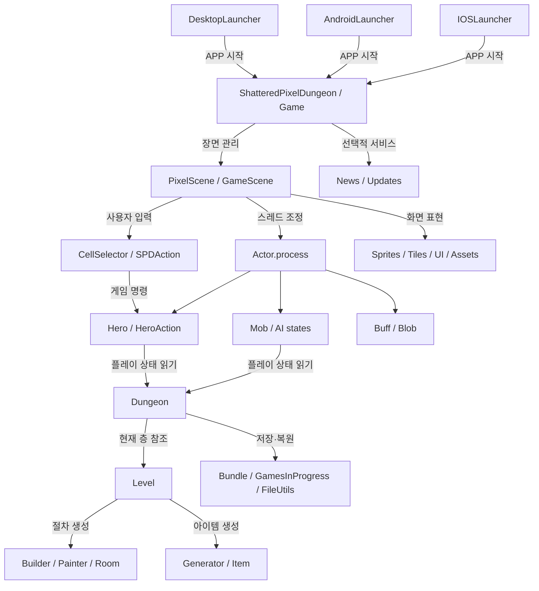

# 코드·파일 연결 관계 총괄

**저장소:** [ikkinamu/lemon-pixel-dungeon](https://github.com/ikkinamu/lemon-pixel-dungeon)  
**코드 분석 기준 커밋:** `bd3a990254e4249458816f4879e93ab87275555b`  
**변경 원칙:** 소스/리소스/Gradle 기존 파일은 변경하지 않으며, 코드 연결을 설명하는 Markdown 파일만 추가한다.

이 문서는 저장소의 파일 간 의존성, 클래스 상속, 메서드 호출, 데이터 전달, 리소스 참조를 **서로 다른 관계 유형으로 분리**한 연결 지도다.

## 1. 관계 유형 — 읽는 법

| 구분 | 확인 가능한 사실 | 주의할 점 | 문서 |
|---|---|---|---|
| **MODULE** | Gradle `project(':...')` 및 빌드 변형 의존 | Java import/런타임 호출이 아님 | [Gradle·플랫폼](RELATIONSHIPS/07_MODULE_DEPENDENCIES.md) |
| **IMPORT** | Java import가 실제 내부 .java 파일을 명시 | 해당 파일의 메서드를 실행한다는 뜻이 아님 | [정방향 목록](RELATIONSHIPS/00_README.md) |
| **INHERIT** | `extends`, `implements` 관계 | 하위 클래스 override와 동적 디스패치 존재 | [상속/포함](RELATIONSHIPS/10_INHERITANCE_COMPOSITION.md) |
| **CALL** | 실제 소스의 메서드 호출 구문 | 조건부 분기·실행 주기는 구분 | [호출 흐름](RELATIONSHIPS/09_CALL_CHAINS.md) |
| **DATA** | 객체 필드, 메서드 매개변수, 저장 객체로 데이터 연결 | 같은 데이터 참조와 복사본이 다름 | [호출·데이터 흐름](RELATIONSHIPS/09_CALL_CHAINS.md) |
| **ASSET** | Assets 상수/리소스 폴더/플랫폼 패키징 | 경로 참조와 실제 로딩·렌더는 다름 | [모듈·리소스](RELATIONSHIPS/07_MODULE_DEPENDENCIES.md) |
| **REVERSE** | 선택된 출발 소스들 중 누가 특정 파일을 import하는지 | 프로젝트 전체의 전수 이용량이 아님 | [역방향 목록](RELATIONSHIPS/08_REVERSE_REFERENCE_INDEX.md) |

## 2. 종합 연결 구조

**해설:** 위 그림은 의존성과 주요 데이터/행동 방향을 묶은 **시스템 지도**다. 한 번의 프레임에서 이 순서로 모든 화살표가 동기 실행된다는 의미가 아니다. 실제 실행 흐름은 아래의 호출 문서에 근거를 붙였다.

## 3. 실행 코드의 직접 연결 예시

| 시작 파일 | 연결 대상 파일 | 직접 확인한 내용 |
|---|---|---|
| `desktop/.../DesktopLauncher.java` | `ShatteredPixelDungeon.java` | 데스크톱에서 게임 객체 생성 후 LWJGL3 앱 실행 |
| `scenes/HeroSelectScene.java` | `Dungeon.java`, `InterlevelScene.java` | 새 게임 시드 설정 후 DESCEND로 장면 변경 |
| `scenes/InterlevelScene.java` | `Dungeon.java`, `levels/Level.java` | 층 생성/복원 선택, `switchLevel()` 호출 |
| `Dungeon.java` | `levels/Level.java`, `levels/RegularLevel.java` | depth/branch에 따른 층 객체 선택과 생성 |
| `levels/RegularLevel.java` | `rooms/Room.java`, `builders/Builder.java`, `painters/Painter.java` | 방 초기화→배치→지형 구성 |
| `scenes/CellSelector.java` | `scenes/GameScene.java` | 화면 셀 선택과 Listener 콜백 |
| `scenes/GameScene.java` | `actors/hero/Hero.java` | 기본 콜백에서 `Dungeon.hero.handle(cell)` 호출 |
| `actors/hero/Hero.java` | `actors/hero/HeroAction.java` | 입력을 Move/Attack 등의 행동 데이터로 구성 |
| `scenes/GameScene.java` | `actors/Actor.java` | 액터 스레드 시작/재개 후 `Actor.process()` |
| `actors/Actor.java` | `actors/hero/Hero.java`, `actors/mobs/Mob.java` | 등록 액터의 시간 기반 `act()` 호출 |
| `actors/mobs/Mob.java` | Mob 내부 `AiState` 구현 | 몬스터 상태에 따른 `state.act()` 호출 |
| `items/Item.java` | `items/bags/Bag.java`, `scenes/GameScene.java` | Bag 수집 성공 시 화면 효과 및 행동 시간 처리 |
| `Dungeon.java` | `GamesInProgress.java`, `Bundle.java` | 게임 공통 저장/층 저장 분리 |

세부 호출·분기·출처 줄 번호: **[09_CALL_CHAINS.md](RELATIONSHIPS/09_CALL_CHAINS.md)**.

## 4. 코드가 공유하는 핵심 데이터

| 소유/보관 위치 | 참조/소비 위치 | 데이터의 의미 |
|---|---|---|
| `Dungeon.hero` | `GameScene`, `Actor`, AI/아이템 처리 | 현재 영웅 객체에 대한 공유 참조 |
| `Dungeon.level` | `Hero`, `Mob`, `GameScene`, `PathFinder` | 현재 층 객체 |
| `Level.map`, `passable`, `heroFOV` | 이동·전투·시야·표시 | 지형 코드/통과 가능/영웅 시야가 서로 다른 배열 |
| `Level.mobs`, `heaps`, `blobs`, `traps` | `Actor.init`, GameScene 등 | 층에 있는 개체 컨테이너 |
| `Hero.curAction` | `Hero.act()` | 현재 영웅이 처리할 구체 행동 객체 |
| `Mob.state` | `Mob.act()` | `AiState` 구현 인스턴스 |
| `Hero.belongings.backpack` | `Item.collect()`, `Bag` | 소지품 객체의 포함/수집 관계 |
| `Dungeon.seed`, `depth`, `branch` | `Level.create()`, `Dungeon.seedForDepth()` | 층별 난수·층 구조의 선택 |
| `GamesInProgress.curSlot` | `Dungeon.saveAll()` | 저장 파일 경로 선택 |
| `News.service`, `Updates.service` | 뉴스·업데이트 래퍼 | 플랫폼별 구현 서비스 참조 |

일부 행은 여러 호출 위치의 상태 사용을 묶은 개략도이며, 특정 함수에서 바로 해당 필드를 읽는지 여부는 해당 파일의 정확한 줄을 확인해야 한다. 특히 공유 참조를 복사본으로 혼동하지 말 것.

## 5. 정방향 및 역방향 import 관계 수집 결과

연결 색인 작성 과정에서 총 **101회 소스 파일을 읽었으며 서로 다른 Java 파일은 98개**였다. 이 중 **93개 파일**에서 최소 하나의 저장소 내부 import 대상을 확인했다.

- 파일별 중복 대상과 출발 파일의 중복을 제거한 내부 **정방향 IMPORT 관계 2,608개**.
- 선택된 출발 파일에서 import한 고유 내부 대상 파일 **759개**.
- 전체 Java 파일 1,323개에 대한 **전수 import 검사 결과는 아님**.
- 같은 패키지 참조, FQCN, 리플렉션, 런타임 객체 생성 및 메서드 호출 등은 import만으로 탐지되지 않을 수 있음.

선별한 출발 파일 중 피참조 수 상위 사례:

| 대상 클래스 파일 | 표본 내 import 출발 파일 수 |
|---|---:|
| `Dungeon.java` | 57 |
| `Messages.java` | 52 |
| `Bundle.java` | 42 |
| `Random.java` | 39 |
| `Game.java` | 38 |
| `GameScene.java` | 34 |
| `Char.java` | 33 |
| `Assets.java` | 33 |
| `Item.java` | 33 |
| `Hero.java` | 28 |

**해설:** '많은 파일이 import한다'는 뜻이지 런타임 중 가장 자주 호출되거나 병목이라는 뜻이 아니다. 출발 파일이 핵심 시스템 중심으로 선정되어 전역 중요도 순위로 일반화하면 안 된다.

## 6. 세부 문서 안내

[RELATIONSHIPS/ 폴더 바로가기](RELATIONSHIPS/)

- [00_README.md](RELATIONSHIPS/00_README.md): 모든 관계 문서 목록과 읽는 방법
- [01_CORE_STATE.md](RELATIONSHIPS/01_CORE_STATE.md): 전역 게임 상태·설정
- [02_ACTORS_AI.md](RELATIONSHIPS/02_ACTORS_AI.md): 액터·AI·상태 효과
- [03_LEVELS_GENERATION.md](RELATIONSHIPS/03_LEVELS_GENERATION.md): 지형·방 생성
- [04_ITEMS_LOOT.md](RELATIONSHIPS/04_ITEMS_LOOT.md): 아이템·장비·드롭
- [05_SCENES_UI.md](RELATIONSHIPS/05_SCENES_UI.md): 장면·UI
- [06_PLATFORM_ENGINE_SERVICES.md](RELATIONSHIPS/06_PLATFORM_ENGINE_SERVICES.md): 기반 엔진·플랫폼·서비스
- [07_MODULE_DEPENDENCIES.md](RELATIONSHIPS/07_MODULE_DEPENDENCIES.md): Gradle·리소스
- [08_REVERSE_REFERENCE_INDEX.md](RELATIONSHIPS/08_REVERSE_REFERENCE_INDEX.md): 역방향 import 참조
- [09_CALL_CHAINS.md](RELATIONSHIPS/09_CALL_CHAINS.md): 실제 호출 및 데이터 처리 흐름
- [10_INHERITANCE_COMPOSITION.md](RELATIONSHIPS/10_INHERITANCE_COMPOSITION.md): 상속·인터페이스·포함

## 7. 모호성 및 미검증 범위

- **`import`와 `call`을 혼동하지 않는다.** 연결지도의 실선은 항상 실행된다는 뜻이 아님.
- **`extends`와 필드 참조는 다르다.** Hero는 Char 상속, Hero의 Bag 보유는 조합.
- **동적 디스패치**: `Actor.act()`는 Hero/Mob/Buff/Blob 등 런타임 실제 유형에 따라 구현이 달라진다.
- **UI vs 게임 상태**: Sprite/Tilemap의 화면 변화와 Level/Char/Item의 게임 규칙이 항상 동일 시점에 갱신되지는 않는다.
- **비동기 경계**: 렌더링 스레드, 액터 스레드, 층 전환 스레드가 있어 호출 순서를 하나로 합치면 부정확하다.
- **선별 분석**: 전체 Java 1,323개 파일의 전수 AST, 정확한 타입 바인딩 및 모든 메서드 호출의 전역 역참조까지 완료한 것은 아니다.
- **테스트**: 빌드/실행/플레이 테스트는 하지 않았다.

관련 문서: [분석 범위와 한계](21_COVERAGE_LIMITS_NEXT_STEPS.md), [모호한 용어 해설](19_AMBIGUITY_AND_INTERPRETATION.md).

---
이 문서는 분석 참고 자료이며 기능을 실행하는 코드가 아니다.
