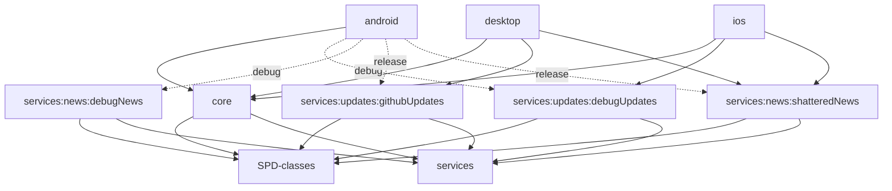
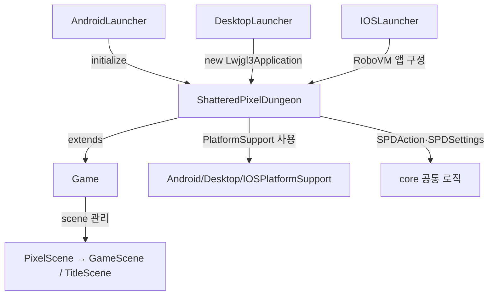

# Gradle 모듈 · 플랫폼 · 리소스 결합도

**대상 코드 시점:** `bd3a990254e4249458816f4879e93ab87275555b`. 이 문서는 `settings.gradle` 및 각 모듈 `build.gradle`에서 **직접 확인한 프로젝트 의존성**을 나타낸다. Java `import`와 구분할 것.

## 1. 전체 Gradle 프로젝트 관계



- 모든 모듈 목록은 [`settings.gradle`](https://github.com/ikkinamu/lemon-pixel-dungeon/blob/bd3a990254e4249458816f4879e93ab87275555b/settings.gradle)에서 확인.
- `core`는 `SPD-classes`를 `api`, `services`를 `implementation`으로 참조([`core/build.gradle`](https://github.com/ikkinamu/lemon-pixel-dungeon/blob/bd3a990254e4249458816f4879e93ab87275555b/core/build.gradle)).
- 서비스 하위 모듈들은 공통 `services`와 `SPD-classes`를 사용(각 하위 Gradle 파일 확인).
- **Android**: debug에는 debugUpdates + debugNews, release에는 githubUpdates + shatteredNews([`android/build.gradle`](https://github.com/ikkinamu/lemon-pixel-dungeon/blob/bd3a990254e4249458816f4879e93ab87275555b/android/build.gradle)).
- **Desktop**: core 및 githubUpdates + shatteredNews([`desktop/build.gradle`](https://github.com/ikkinamu/lemon-pixel-dungeon/blob/bd3a990254e4249458816f4879e93ab87275555b/desktop/build.gradle)).
- **iOS**: core 및 debugUpdates + shatteredNews([`ios/build.gradle`](https://github.com/ikkinamu/lemon-pixel-dungeon/blob/bd3a990254e4249458816f4879e93ab87275555b/ios/build.gradle)).

**주의:** `debug`와 `release` 화살표가 모두 표시되어 있지만, 한 빌드에 두 변형 구현이 무조건 동시에 포함된다는 뜻은 아니다. 선택된 Gradle 빌드 변형에 따른다.

## 2. 구성별 주요 외부 의존성

| 프로젝트 | 확인된 외부 기술 |
|---|---|
| SPD-classes | libGDX 코어·컨트롤러, FreeType, org.json |
| Desktop | libGDX LWJGL3 백엔드, 데스크톱 네이티브 라이브러리, tinyfd |
| Android | Android libGDX 백엔드, Android용 네이티브 라이브러리/FreeType |
| iOS | RoboVM, libGDX RoboVM MetalANGLE 백엔드 |
| Services | 추상 API를 공통 모듈에 놓고 플랫폼별 구현을 별도 모듈로 분리 |

- `build.gradle`의 `gdxVersion` 등은 전역 버전 설정이고, Java 파일 간 연결을 의미하지 않는다.
- iOS가 특정 백엔드 버전으로 고정한 이유는 Gradle 주석에 포함되지만, 실제 현재 하드웨어에서 검증된 사실이라고 단정하지 않는다.

## 3. 주요 런타임 진입 경로



기반 Game은 [`SPD-classes/src/main/java/com/watabou/noosa/Game.java`](https://github.com/ikkinamu/lemon-pixel-dungeon/blob/bd3a990254e4249458816f4879e93ab87275555b/SPD-classes/src/main/java/com/watabou/noosa/Game.java)에 있고, 실제 공통 게임 진입 클래스는 [`core/src/main/java/com/shatteredpixel/shatteredpixeldungeon/ShatteredPixelDungeon.java`](https://github.com/ikkinamu/lemon-pixel-dungeon/blob/bd3a990254e4249458816f4879e93ab87275555b/core/src/main/java/com/shatteredpixel/shatteredpixeldungeon/ShatteredPixelDungeon.java).

## 4. 서비스의 인터페이스·구현 분리

```text
각 플랫폼 Launcher
 ├─ News.service = NewsImpl.getNewsService() (지원할 때)
 │    └─ NewsService(추상) ← ShatteredNews / DebugNews(구현)
 └─ Updates.service = UpdateImpl.getUpdateService() (지원할 때)
      └─ UpdateService(추상) ← GitHubUpdates / DebugUpdates(구현)
```

- 추상 인터페이스: `services/src/main/java/.../services/news/NewsService.java`, `.../updates/UpdateService.java`.
- 공통 코드 래퍼: `core/src/main/java/.../services/news/News.java`, `.../updates/Updates.java`.
- 선택된 구현의 구체 메서드는 빌드 변형/플랫폼/지원 여부에 따라 결정.
- 실제 네트워크 성공 여부는 정적 모듈 구조만으로 결론 내릴 수 없음.

## 5. 리소스와 Java 코드의 연결

```text
core/src/main/assets
  ├─ sprites/        → Assets.Sprites의 파일 경로 값 → 각 Sprite 생성자/텍스처 로더
  ├─ environment/    → Assets.Environment 상수 → Tilemap 및 GameScene
  ├─ sounds/, music/ → Assets.Sounds/Music → Sample/Music 서브시스템
  ├─ messages/       → Messages.java, Languages.java → UI 문자열
  ├─ interfaces/     → UI 아이콘·버튼 이미지
  └─ fonts/          → 플랫폼별 글꼴 생성기
```

실제 자산 루트는 [`core/src/main/java/com/shatteredpixel/shatteredpixeldungeon/Assets.java`](https://github.com/ikkinamu/lemon-pixel-dungeon/blob/bd3a990254e4249458816f4879e93ab87275555b/core/src/main/java/com/shatteredpixel/shatteredpixeldungeon/Assets.java)의 상대 경로 상수에서 확인 가능.

- Android Gradle은 `sourceSets.main.assets.srcDirs`를 통해 `core/src/main/assets`를 참조.
- Desktop Gradle은 `processResources`에서 core 및 desktop의 assets 폴더를 읽음.
- iOS는 `ios/assets`의 음악·Xcode 자산 관련 파일도 별도로 보유. 정확한 모든 런타임 자산 파일 로딩 경로는 플랫폼 번들러 확인 필요.

**중요:** `Assets.java`는 파일 경로를 담는 Java 코드이고 실제 음악/PNG/번역 파일은 `assets/` 폴더에 있다. `import Assets`를 했다는 이유만으로 그 파일에서 모든 이미지를 로드하지는 않는다.

## 6. 확인되지 않은 관계

- Gradle 플러그인 실행시 동적으로 추가되는 모든 종속성의 완전 목록은 현재 소스 정적 읽기로 확정하지 못함.
- reflection, 등록된 콜백과 외부 libGDX 런타임 디스패치의 정확한 타이밍은 별도 실행 확인 필요.
- Java import의 세부 파일 단위 연결은 같은 폴더의 `01_CORE_STATE.md`~`06_PLATFORM_ENGINE_SERVICES.md`를 참조.

이 문서는 기존 소스 파일·빌드 설정을 수정하지 않는 설명용 문서다.
