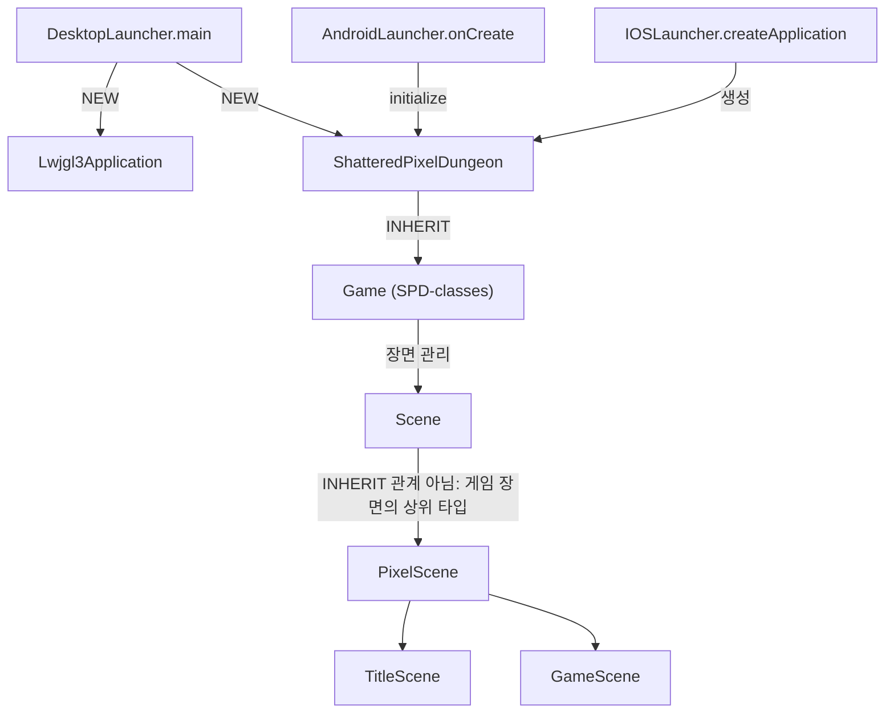
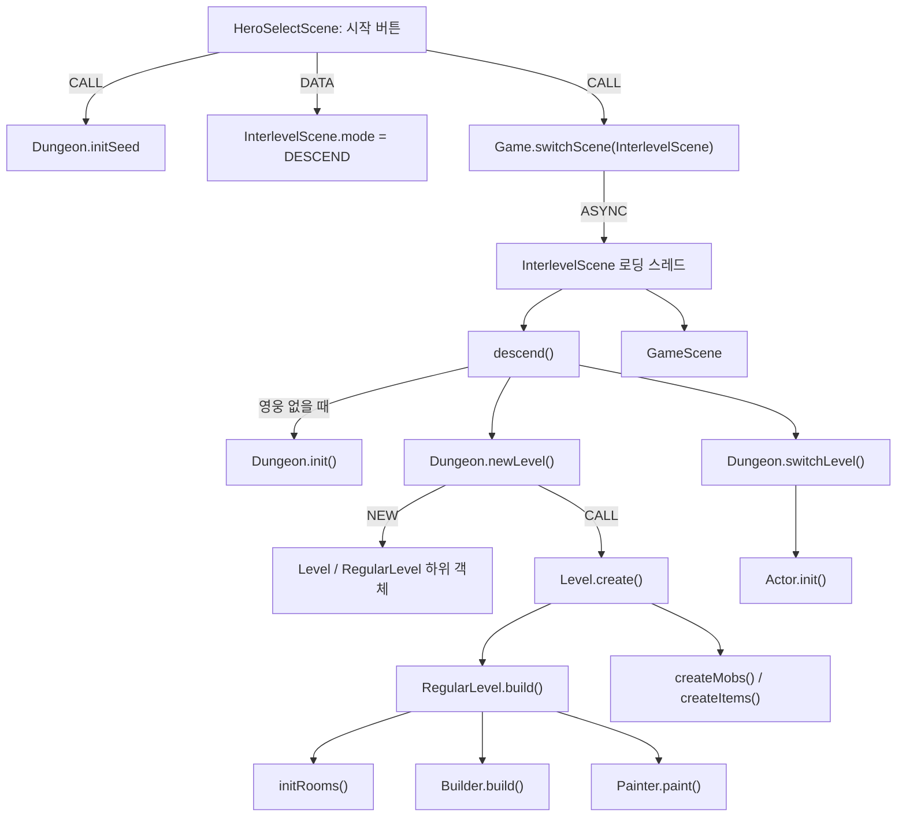
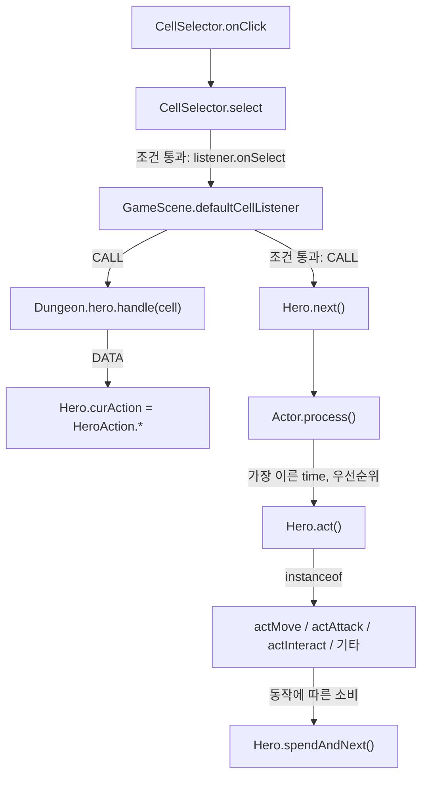
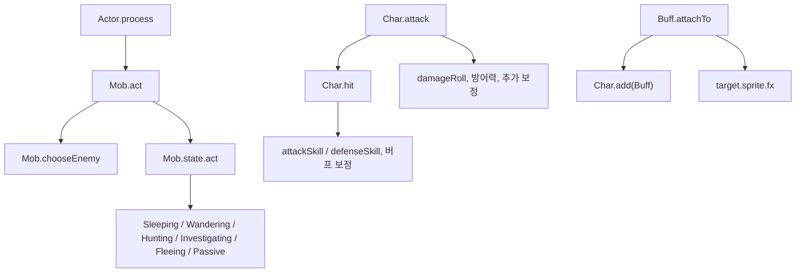
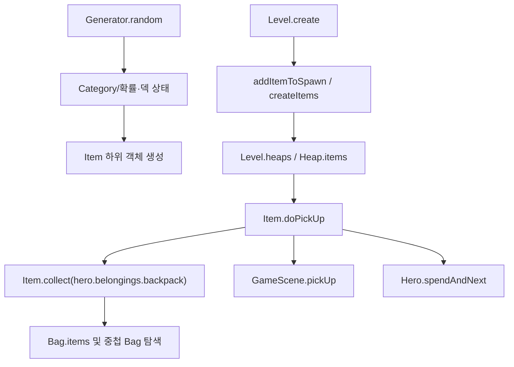
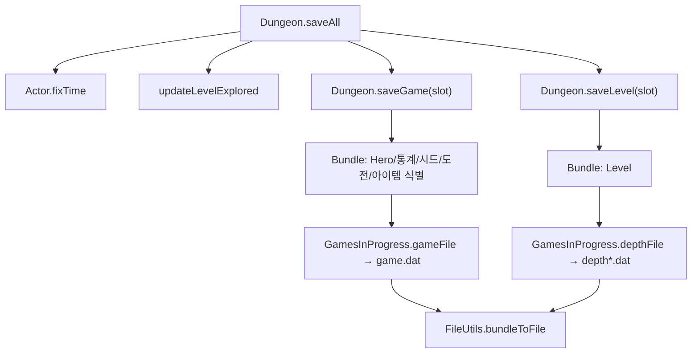
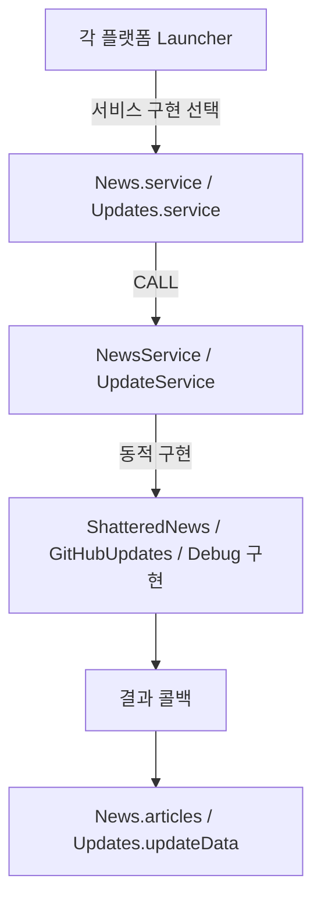

# 실제 메서드 호출·데이터 흐름 — 근거가 있는 연결 사슬

**코드 근거:** `bd3a990254e4249458816f4879e93ab87275555b` (정적 코드 열람 시점). 여기의 화살표는 **호출(CALL)**, **상속(INHERIT)**, **객체 생성(NEW)**, **상태 전달(DATA)**, **비동기 실행(ASYNC)**을 구분하려고 작성했다. 각 경로는 대표 분기이며 모든 조건에서 무조건 실행되는 일직선 호출 순서가 아니다.

## 1. 실행 진입 → 공통 게임 엔진

도식의 `Scene → PixelScene`는 실제 **PixelScene extends Scene** 관계를 나타낸다. 나머지 `Game → Scene`는 장면 보유/전환 관계이며 상속이 아니다.

- [DesktopLauncher.java L145–205](https://github.com/ikkinamu/lemon-pixel-dungeon/blob/bd3a990254e4249458816f4879e93ab87275555b/desktop/src/main/java/com/shatteredpixel/shatteredpixeldungeon/desktop/DesktopLauncher.java#L145-L205): `new Lwjgl3Application(new ShatteredPixelDungeon(new DesktopPlatformSupport()), config)`.
- [AndroidLauncher.java L163–170](https://github.com/ikkinamu/lemon-pixel-dungeon/blob/bd3a990254e4249458816f4879e93ab87275555b/android/src/main/java/com/shatteredpixel/shatteredpixeldungeon/android/AndroidLauncher.java#L163-L170): `initialize(new ShatteredPixelDungeon(support), config)`.
- [IOSLauncher.java L54–86](https://github.com/ikkinamu/lemon-pixel-dungeon/blob/bd3a990254e4249458816f4879e93ab87275555b/ios/src/main/java/com/shatteredpixel/shatteredpixeldungeon/ios/IOSLauncher.java#L54-L86): RoboVM iOS 앱 설정·서비스 연결. 생성자의 자세한 호출 분기는 파일 끝까지 보아야 함.
- [Game.java L45–122](https://github.com/ikkinamu/lemon-pixel-dungeon/blob/bd3a990254e4249458816f4879e93ab87275555b/SPD-classes/src/main/java/com/watabou/noosa/Game.java#L45-L122): ApplicationListener 생명주기, 장면 관리.
- [ShatteredPixelDungeon.java L37–81](https://github.com/ikkinamu/lemon-pixel-dungeon/blob/bd3a990254e4249458816f4879e93ab87275555b/core/src/main/java/com/shatteredpixel/shatteredpixeldungeon/ShatteredPixelDungeon.java#L37-L81): Game을 상속하고 초기화·시스템 UI·바인딩·오디오 연결.
- [Scene.java L29–57](https://github.com/ikkinamu/lemon-pixel-dungeon/blob/bd3a990254e4249458816f4879e93ab87275555b/SPD-classes/src/main/java/com/watabou/noosa/Scene.java#L29-L57)와 [PixelScene.java L64–96](https://github.com/ikkinamu/lemon-pixel-dungeon/blob/bd3a990254e4249458816f4879e93ab87275555b/core/src/main/java/com/shatteredpixel/shatteredpixeldungeon/scenes/PixelScene.java#L64-L96).

**해설:** `new ShatteredPixelDungeon(...)`는 공통 게임 객체 생성이지 곧바로 새 플레이 저장 슬롯을 생성한다는 뜻이 아니다. 새 게임 초기화는 아래 별도 경로다.

## 2. 새 게임 시작 → 층 생성 → 게임 장면

근거:
- [HeroSelectScene.java L152–164](https://github.com/ikkinamu/lemon-pixel-dungeon/blob/bd3a990254e4249458816f4879e93ab87275555b/core/src/main/java/com/shatteredpixel/shatteredpixeldungeon/scenes/HeroSelectScene.java#L152-L164): `Dungeon.initSeed()`, DESCEND 설정, `Game.switchScene(InterlevelScene.class)`가 실제로 연속 호출됨.
- [InterlevelScene.java L410–455](https://github.com/ikkinamu/lemon-pixel-dungeon/blob/bd3a990254e4249458816f4879e93ab87275555b/core/src/main/java/com/shatteredpixel/shatteredpixeldungeon/scenes/InterlevelScene.java#L410-L455): 별도 스레드의 `switch(mode)`와 `descend()` 호출.
- [InterlevelScene.java L623–675](https://github.com/ikkinamu/lemon-pixel-dungeon/blob/bd3a990254e4249458816f4879e93ab87275555b/core/src/main/java/com/shatteredpixel/shatteredpixeldungeon/scenes/InterlevelScene.java#L623-L675): 최초에는 `Dungeon.init()→Dungeon.newLevel()→Dungeon.switchLevel()`; 재진입 시에는 `loadLevel()` 또는 `newLevel()` 분기.
- [Dungeon.java L233–288](https://github.com/ikkinamu/lemon-pixel-dungeon/blob/bd3a990254e4249458816f4879e93ab87275555b/core/src/main/java/com/shatteredpixel/shatteredpixeldungeon/Dungeon.java#L233-L288): Hero 생성, 게임 상태 및 확률·아이템 식별 시스템 초기화.
- [Dungeon.java L297–405](https://github.com/ikkinamu/lemon-pixel-dungeon/blob/bd3a990254e4249458816f4879e93ab87275555b/core/src/main/java/com/shatteredpixel/shatteredpixeldungeon/Dungeon.java#L297-L405): depth/branch에 따라 Level 하위 클래스 선택 후 `level.create()`.
- [Level.java L218–326](https://github.com/ikkinamu/lemon-pixel-dungeon/blob/bd3a990254e4249458816f4879e93ab87275555b/core/src/main/java/com/shatteredpixel/shatteredpixeldungeon/levels/Level.java#L218-L326): 시드, 스폰 아이템 예약, build(), 필드 플래그, 몬스터/아이템 생성.
- [RegularLevel.java L105–191](https://github.com/ikkinamu/lemon-pixel-dungeon/blob/bd3a990254e4249458816f4879e93ab87275555b/core/src/main/java/com/shatteredpixel/shatteredpixeldungeon/levels/RegularLevel.java#L105-L191): `initRooms()`, `builder.build()`, `painter().paint()`.
- [Dungeon.java L464–518](https://github.com/ikkinamu/lemon-pixel-dungeon/blob/bd3a990254e4249458816f4879e93ab87275555b/core/src/main/java/com/shatteredpixel/shatteredpixeldungeon/Dungeon.java#L464-L518): `Actor.init()`, level 설정, 영웅 위치·시야·저장.

**해설:** `Builder`는 추상 타입이며 실제 구현은 층과 난수에 따라 달라진다. `Painter`는 게임 이미지를 그리는 UI 화가가 아니라 지형 데이터를 구성하는 맵 생성 객체다. `GameScene`은 Level 자체가 아니라 Level을 플레이 화면에 구성하는 장면이다.

## 3. 화면 클릭 → 영웅 행동 → 액터 스케줄러

- [CellSelector.java L79–128](https://github.com/ikkinamu/lemon-pixel-dungeon/blob/bd3a990254e4249458816f4879e93ab87275555b/core/src/main/java/com/shatteredpixel/shatteredpixeldungeon/scenes/CellSelector.java#L79-L128): 포인터 좌표에서 영웅/몬스터/아이템 더미를 우선 판정하여 셀 선택.
- [CellSelector.java L152–171](https://github.com/ikkinamu/lemon-pixel-dungeon/blob/bd3a990254e4249458816f4879e93ab87275555b/core/src/main/java/com/shatteredpixel/shatteredpixeldungeon/scenes/CellSelector.java#L152-L171): `enabled`, `Dungeon.hero.ready`, 인터페이스 차단 여부가 통과되어야 listener에 전달.
- [GameScene.java L1842–1848](https://github.com/ikkinamu/lemon-pixel-dungeon/blob/bd3a990254e4249458816f4879e93ab87275555b/core/src/main/java/com/shatteredpixel/shatteredpixeldungeon/scenes/GameScene.java#L1842-L1848): 기본 리스너에서 `Dungeon.hero.handle(cell)` 호출, 반환이 true면 `Dungeon.hero.next()` 호출.
- [Hero.java L1900–2007](https://github.com/ikkinamu/lemon-pixel-dungeon/blob/bd3a990254e4249458816f4879e93ab87275555b/core/src/main/java/com/shatteredpixel/shatteredpixeldungeon/actors/hero/Hero.java#L1900-L2007): handle이 목적지/상황에 따른 `HeroAction` 등을 기록.
- [HeroAction.java L26–92](https://github.com/ikkinamu/lemon-pixel-dungeon/blob/bd3a990254e4249458816f4879e93ab87275555b/core/src/main/java/com/shatteredpixel/shatteredpixeldungeon/actors/hero/HeroAction.java#L26-L92): 행동 객체 Move/Attack/PickUp/Interact 등.
- [Hero.java L829–948](https://github.com/ikkinamu/lemon-pixel-dungeon/blob/bd3a990254e4249458816f4879e93ab87275555b/core/src/main/java/com/shatteredpixel/shatteredpixeldungeon/actors/hero/Hero.java#L829-L948): `Hero.act()`에서 `curAction instanceof ...`에 따라 실제 동작 메서드 분기.
- [GameScene.java L869–925](https://github.com/ikkinamu/lemon-pixel-dungeon/blob/bd3a990254e4249458816f4879e93ab87275555b/core/src/main/java/com/shatteredpixel/shatteredpixeldungeon/scenes/GameScene.java#L869-L925): 별도 액터 스레드를 시작하거나 `notify()`로 재개 요청.
- [Actor.java L250–334](https://github.com/ikkinamu/lemon-pixel-dungeon/blob/bd3a990254e4249458816f4879e93ab87275555b/core/src/main/java/com/shatteredpixel/shatteredpixeldungeon/actors/Actor.java#L250-L334): 시간·우선순위를 비교해 다음 Actor를 선택하고 `act()` 호출.

**주의:** 이 도식에서 `Hero.next → Actor.process`는 **스케줄 처리를 다시 진행시키는 연결**을 요약한 것. Java 코드상 `Hero.next()`가 곧바로 `Actor.process()`를 일반 동기 메서드 호출하는 것으로 표현하면 부정확하다. 렌더 스레드와 액터 스레드의 조정이 끼어 있다.

## 4. 몬스터 AI · 버프 · 전투

- [Actor.java L250–334](https://github.com/ikkinamu/lemon-pixel-dungeon/blob/bd3a990254e4249458816f4879e93ab87275555b/core/src/main/java/com/shatteredpixel/shatteredpixeldungeon/actors/Actor.java#L250-L334): 스케줄러가 선택한 액터의 `act()`를 실행.
- [Mob.java L263–317](https://github.com/ikkinamu/lemon-pixel-dungeon/blob/bd3a990254e4249458816f4879e93ab87275555b/core/src/main/java/com/shatteredpixel/shatteredpixeldungeon/actors/mobs/Mob.java#L263-L317): `super.act()`, 적 대상 `chooseEnemy()`, 시야 확인, `state.act(...)`로 AI 실행.
- [Mob.java L1215–1245](https://github.com/ikkinamu/lemon-pixel-dungeon/blob/bd3a990254e4249458816f4879e93ab87275555b/core/src/main/java/com/shatteredpixel/shatteredpixeldungeon/actors/mobs/Mob.java#L1215-L1245): `AiState` 인터페이스와 상태 클래스 구현.
- [Char.java L368–453](https://github.com/ikkinamu/lemon-pixel-dungeon/blob/bd3a990254e4249458816f4879e93ab87275555b/core/src/main/java/com/shatteredpixel/shatteredpixeldungeon/actors/Char.java#L368-L453): 공격 처리에서 적의 상태, 명중, 피해량·방어 감소 등 참조.
- [Char.java L615–686](https://github.com/ikkinamu/lemon-pixel-dungeon/blob/bd3a990254e4249458816f4879e93ab87275555b/core/src/main/java/com/shatteredpixel/shatteredpixeldungeon/actors/Char.java#L615-L686): 실제 명중 굴림(특례 + 공격/방어 수치 + 무작위값 + 버프).
- [Buff.java L67–95](https://github.com/ikkinamu/lemon-pixel-dungeon/blob/bd3a990254e4249458816f4879e93ab87275555b/core/src/main/java/com/shatteredpixel/shatteredpixeldungeon/actors/buffs/Buff.java#L67-L95): 면역 검사 → target 참조 저장 → `Char.add()` 성공 여부 → 시각 효과 연결.

**해설:** `state.act()`는 모든 몬스터에서 같은 함수 본문을 실행하지 않는다(동적 디스패치). `Buff`는 긍정적/부정적/중립 효과를 모두 포함하므로 클래스명만으로 이로운 효과라고 판단하면 안 됨.

## 5. 아이템 사용·수집·드롭

- [Generator.java L620–749](https://github.com/ikkinamu/lemon-pixel-dungeon/blob/bd3a990254e4249458816f4879e93ab87275555b/core/src/main/java/com/shatteredpixel/shatteredpixeldungeon/items/Generator.java#L620-L749): 분류별 확률·덱 소진, 리셋, 실제 클래스 객체 생성.
- [Level.java L218–326](https://github.com/ikkinamu/lemon-pixel-dungeon/blob/bd3a990254e4249458816f4879e93ab87275555b/core/src/main/java/com/shatteredpixel/shatteredpixeldungeon/levels/Level.java#L218-L326): 지형 생성 중 일부 아이템을 예약하고 `createItems()`를 호출.
- [Heap.java L60–82](https://github.com/ikkinamu/lemon-pixel-dungeon/blob/bd3a990254e4249458816f4879e93ab87275555b/core/src/main/java/com/shatteredpixel/shatteredpixeldungeon/items/Heap.java#L60-L82): 위치와 여러 Item의 묶음.
- [Item.java L121–136](https://github.com/ikkinamu/lemon-pixel-dungeon/blob/bd3a990254e4249458816f4879e93ab87275555b/core/src/main/java/com/shatteredpixel/shatteredpixeldungeon/items/Item.java#L121-L136): `collect(hero.belongings.backpack)` 성공 시 시각 처리·소리·시간 소비.
- [Item.java L204–270](https://github.com/ikkinamu/lemon-pixel-dungeon/blob/bd3a990254e4249458816f4879e93ab87275555b/core/src/main/java/com/shatteredpixel/shatteredpixeldungeon/items/Item.java#L204-L270): 중첩 가방, 용량, 스택 병합, 업적/재능/발견 추적.
- [Bag.java L38–115](https://github.com/ikkinamu/lemon-pixel-dungeon/blob/bd3a990254e4249458816f4879e93ab87275555b/core/src/main/java/com/shatteredpixel/shatteredpixeldungeon/items/bags/Bag.java#L38-L115): Item 하위 타입인 가방과 소지품 목록.

**주의:** 그림의 Level → Heap 연결은 설계상 아이템이 놓이는 상태를 간략하게 설명한 것이지, `Level.create()` 내부에서 모든 아이템이 곧바로 반드시 Heap으로 저장된다는 뜻이 아니다. 배치 과정의 실제 분기는 `createItems()`와 `Level.drop()` 호출 경로까지 확인해야 한다.

## 6. 저장·복원·세이브 파일 위치

- [Dungeon.java L620–720](https://github.com/ikkinamu/lemon-pixel-dungeon/blob/bd3a990254e4249458816f4879e93ab87275555b/core/src/main/java/com/shatteredpixel/shatteredpixeldungeon/Dungeon.java#L620-L720): 저장 메서드 구현.
- [GamesInProgress.java L38–70](https://github.com/ikkinamu/lemon-pixel-dungeon/blob/bd3a990254e4249458816f4879e93ab87275555b/core/src/main/java/com/shatteredpixel/shatteredpixeldungeon/GamesInProgress.java#L38-L70): 저장 슬롯 경로 `game%d/game.dat`, `depth%d.dat`, 분기 경로 `depth%d-branch%d.dat`.
- [Bundle.java L46–170](https://github.com/ikkinamu/lemon-pixel-dungeon/blob/bd3a990254e4249458816f4879e93ab87275555b/SPD-classes/src/main/java/com/watabou/utils/Bundle.java#L46-L170): Bundlable 및 키-값 방식의 직렬화 래퍼.
- [Dungeon.java L720–855](https://github.com/ikkinamu/lemon-pixel-dungeon/blob/bd3a990254e4249458816f4879e93ab87275555b/core/src/main/java/com/shatteredpixel/shatteredpixeldungeon/Dungeon.java#L720-L855): loadGame/loadLevel과 복원 경로.

**주의:** `saveGame()`과 `saveLevel()`은 예외 처리 방식이 다르며, 저장은 파일 두 부류로 분리된다. `Bundle`은 메모리상 구성 자료이지 곧바로 평문 JSON 확장자를 의미하지 않는다.

## 7. 뉴스/업데이트: 인터페이스 → 플랫폼 구현 → 콜백

- [News.java L38–77](https://github.com/ikkinamu/lemon-pixel-dungeon/blob/bd3a990254e4249458816f4879e93ab87275555b/core/src/main/java/com/shatteredpixel/shatteredpixeldungeon/services/news/News.java#L38-L77): service 객체의 유무 확인 및 NewsService.checkForArticles 콜백, 성공/실패 상태 기록.
- [NewsService.java L26–36](https://github.com/ikkinamu/lemon-pixel-dungeon/blob/bd3a990254e4249458816f4879e93ab87275555b/services/src/main/java/com/shatteredpixel/shatteredpixeldungeon/services/news/NewsService.java#L26-L36): 추상 API 및 콜백.
- [ShatteredNews.java L37–114](https://github.com/ikkinamu/lemon-pixel-dungeon/blob/bd3a990254e4249458816f4879e93ab87275555b/services/news/shatteredNews/src/main/java/com/shatteredpixel/shatteredpixeldungeon/services/news/ShatteredNews.java#L37-L114): 실제 HTTP 뉴스 구현.
- [Updates.java L29–119](https://github.com/ikkinamu/lemon-pixel-dungeon/blob/bd3a990254e4249458816f4879e93ab87275555b/core/src/main/java/com/shatteredpixel/shatteredpixeldungeon/services/updates/Updates.java#L29-L119) 및 [UpdateService.java L26–56](https://github.com/ikkinamu/lemon-pixel-dungeon/blob/bd3a990254e4249458816f4879e93ab87275555b/services/src/main/java/com/shatteredpixel/shatteredpixeldungeon/services/updates/UpdateService.java#L26-L56).
- [GitHubUpdates.java L36–170](https://github.com/ikkinamu/lemon-pixel-dungeon/blob/bd3a990254e4249458816f4879e93ab87275555b/services/updates/githubUpdates/src/main/java/com/shatteredpixel/shatteredpixeldungeon/services/updates/GitHubUpdates.java#L36-L170).

**주의:** 서비스 구현은 플랫폼과 빌드 형식에서 결정됨. 인터넷 요청 성공/실패는 별도 런타임 상태이며 `import`만으로 '온라인 필수 게임'이라고 결론내릴 수 없다.

## 8. 호출 관계 vs 정적 import: 중요한 구분

| 표기 | 의미 | 확인 방식 |
|---|---|---|
| `import A.B` | 타입 이름이 컴파일 문맥에 보임 | 01~06 정방향 파일 색인 |
| `class Child extends Parent` | 정적 상속 관계 | 클래스 선언 확인 |
| `new ClassName(...)` | 객체 생성 구문 존재 | 호출 위치 확인; 분기에 따라 실행 안 될 수 있음 |
| `X.method(...)` | 코드상 메서드 호출 구문 존재 | `X` 타입·가상 디스패치·오버로드는 별도 확인 |
| `field = value` | 상태 데이터 저장/전달 | 필드의 수명·소유자·스레드 경계 확인 |
| `Thread.start / notify` | 비동기 작업 실행/재개 | **순차 호출과 같지 않음** |
| `Assets.Foo` | 리소스 경로 상수 참조 | 리소스 실제 로드/렌더 사용과 구분 |

## 조사 범위와 제한

이 문서는 **실제로 열어 확인한 대표 소스의 구체적인 경로**에 초점을 맞춘 수동 검증된 관계 설명이다. 모든 하위 클래스의 런타임 호출 그래프는 아니다. 서브클래스 override, 리플렉션, 동시성, 저장 호환성은 전체 AST와 실제 실행 테스트가 있어야 검증 가능하다. 코드·설정·자산은 수정하지 않았다.
