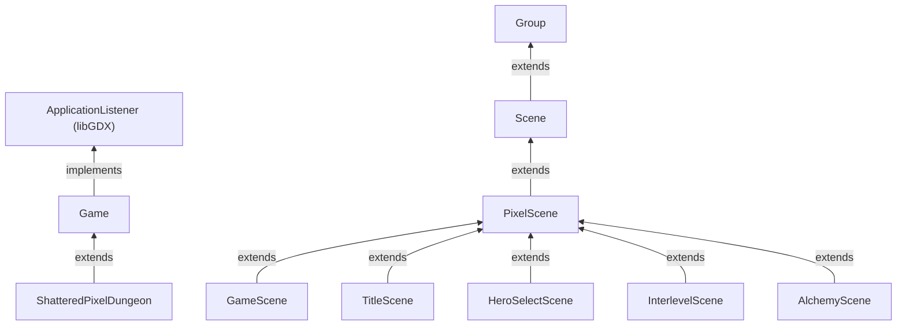
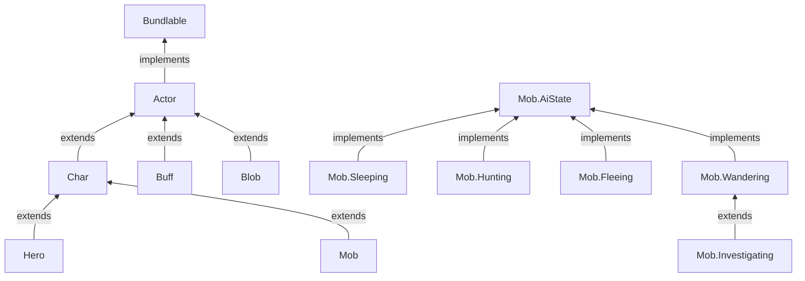
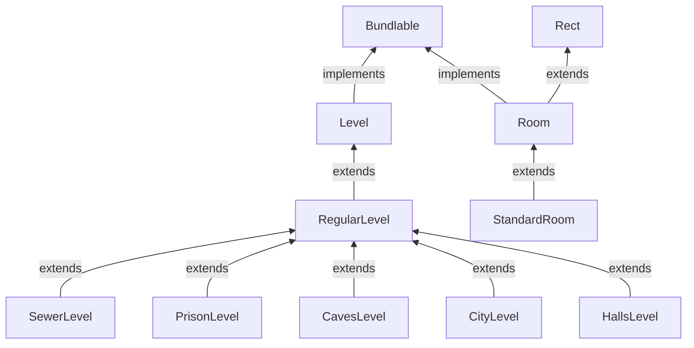
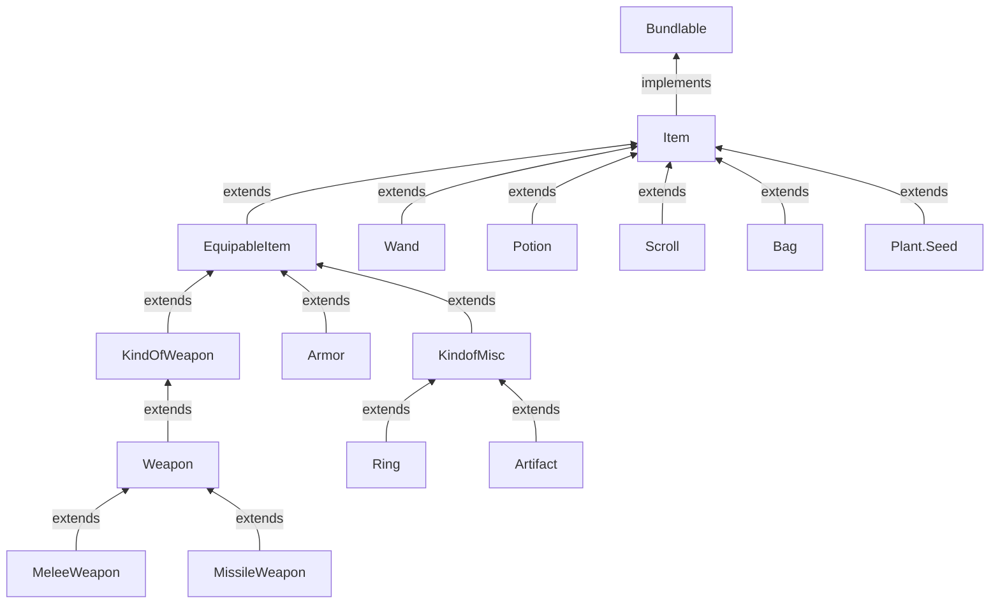
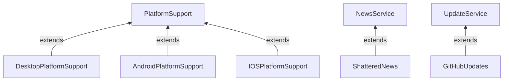

# 클래스 상속·인터페이스·객체 조합 관계

기준 소스 커밋 `bd3a990254e4249458816f4879e93ab87275555b`. 각 도식은 실제 열람한 `extends`/`implements` 선언의 대표 관계다. **상속 그래프는 함수 호출 그래프가 아니다.** 표기 `Child --> Parent`는 자식 타입이 부모 타입을 상속한다는 뜻.

## 게임 엔진과 화면

- [`ShatteredPixelDungeon.java`](https://github.com/ikkinamu/lemon-pixel-dungeon/blob/bd3a990254e4249458816f4879e93ab87275555b/core/src/main/java/com/shatteredpixel/shatteredpixeldungeon/ShatteredPixelDungeon.java), [`Game.java`](https://github.com/ikkinamu/lemon-pixel-dungeon/blob/bd3a990254e4249458816f4879e93ab87275555b/SPD-classes/src/main/java/com/watabou/noosa/Game.java), [`Scene.java`](https://github.com/ikkinamu/lemon-pixel-dungeon/blob/bd3a990254e4249458816f4879e93ab87275555b/SPD-classes/src/main/java/com/watabou/noosa/Scene.java), [`PixelScene.java`](https://github.com/ikkinamu/lemon-pixel-dungeon/blob/bd3a990254e4249458816f4879e93ab87275555b/core/src/main/java/com/shatteredpixel/shatteredpixeldungeon/scenes/PixelScene.java).
- [`GameScene.java`](https://github.com/ikkinamu/lemon-pixel-dungeon/blob/bd3a990254e4249458816f4879e93ab87275555b/core/src/main/java/com/shatteredpixel/shatteredpixeldungeon/scenes/GameScene.java), [`TitleScene.java`](https://github.com/ikkinamu/lemon-pixel-dungeon/blob/bd3a990254e4249458816f4879e93ab87275555b/core/src/main/java/com/shatteredpixel/shatteredpixeldungeon/scenes/TitleScene.java), [`HeroSelectScene.java`](https://github.com/ikkinamu/lemon-pixel-dungeon/blob/bd3a990254e4249458816f4879e93ab87275555b/core/src/main/java/com/shatteredpixel/shatteredpixeldungeon/scenes/HeroSelectScene.java), [`InterlevelScene.java`](https://github.com/ikkinamu/lemon-pixel-dungeon/blob/bd3a990254e4249458816f4879e93ab87275555b/core/src/main/java/com/shatteredpixel/shatteredpixeldungeon/scenes/InterlevelScene.java), [`AlchemyScene.java`](https://github.com/ikkinamu/lemon-pixel-dungeon/blob/bd3a990254e4249458816f4879e93ab87275555b/core/src/main/java/com/shatteredpixel/shatteredpixeldungeon/scenes/AlchemyScene.java).

`Game`가 `Scene`을 상속하는 것은 아니다. Game은 Scene을 보유하고 교체하는 역할이다.

## 액터와 AI

- [`Actor.java`](https://github.com/ikkinamu/lemon-pixel-dungeon/blob/bd3a990254e4249458816f4879e93ab87275555b/core/src/main/java/com/shatteredpixel/shatteredpixeldungeon/actors/Actor.java), [`Char.java`](https://github.com/ikkinamu/lemon-pixel-dungeon/blob/bd3a990254e4249458816f4879e93ab87275555b/core/src/main/java/com/shatteredpixel/shatteredpixeldungeon/actors/Char.java), [`Hero.java`](https://github.com/ikkinamu/lemon-pixel-dungeon/blob/bd3a990254e4249458816f4879e93ab87275555b/core/src/main/java/com/shatteredpixel/shatteredpixeldungeon/actors/hero/Hero.java), [`Mob.java`](https://github.com/ikkinamu/lemon-pixel-dungeon/blob/bd3a990254e4249458816f4879e93ab87275555b/core/src/main/java/com/shatteredpixel/shatteredpixeldungeon/actors/mobs/Mob.java), [`Buff.java`](https://github.com/ikkinamu/lemon-pixel-dungeon/blob/bd3a990254e4249458816f4879e93ab87275555b/core/src/main/java/com/shatteredpixel/shatteredpixeldungeon/actors/buffs/Buff.java), [`Blob.java`](https://github.com/ikkinamu/lemon-pixel-dungeon/blob/bd3a990254e4249458816f4879e93ab87275555b/core/src/main/java/com/shatteredpixel/shatteredpixeldungeon/actors/blobs/Blob.java).

**중요:** `Mob.state`는 상속받은 Actor 필드가 아니라 Mob의 AiState 객체 참조다. `Mob`과 `Buff`는 **Char의 자식 관계가 아니다**. Buff는 별개의 Actor이며 Char에 부착되는 관계.

## 지형과 방 생성

- [`Level.java`](https://github.com/ikkinamu/lemon-pixel-dungeon/blob/bd3a990254e4249458816f4879e93ab87275555b/core/src/main/java/com/shatteredpixel/shatteredpixeldungeon/levels/Level.java), [`RegularLevel.java`](https://github.com/ikkinamu/lemon-pixel-dungeon/blob/bd3a990254e4249458816f4879e93ab87275555b/core/src/main/java/com/shatteredpixel/shatteredpixeldungeon/levels/RegularLevel.java), [`SewerLevel.java`](https://github.com/ikkinamu/lemon-pixel-dungeon/blob/bd3a990254e4249458816f4879e93ab87275555b/core/src/main/java/com/shatteredpixel/shatteredpixeldungeon/levels/SewerLevel.java), [`Room.java`](https://github.com/ikkinamu/lemon-pixel-dungeon/blob/bd3a990254e4249458816f4879e93ab87275555b/core/src/main/java/com/shatteredpixel/shatteredpixeldungeon/levels/rooms/Room.java), [`StandardRoom.java`](https://github.com/ikkinamu/lemon-pixel-dungeon/blob/bd3a990254e4249458816f4879e93ab87275555b/core/src/main/java/com/shatteredpixel/shatteredpixeldungeon/levels/rooms/standard/StandardRoom.java).

**생성 시 의존:** Level.create는 `build()`를 호출하고, RegularLevel의 구현은 Builder와 Painter를 사용하는 **객체 조합·동적 구현 선택** 관계다. `Builder extends Level`, `Painter extends Room` 같은 상속은 존재하지 않음.

## 아이템/보관

대표 소스: [`Item.java`](https://github.com/ikkinamu/lemon-pixel-dungeon/blob/bd3a990254e4249458816f4879e93ab87275555b/core/src/main/java/com/shatteredpixel/shatteredpixeldungeon/items/Item.java), [`EquipableItem.java`](https://github.com/ikkinamu/lemon-pixel-dungeon/blob/bd3a990254e4249458816f4879e93ab87275555b/core/src/main/java/com/shatteredpixel/shatteredpixeldungeon/items/EquipableItem.java), [`KindOfWeapon.java`](https://github.com/ikkinamu/lemon-pixel-dungeon/blob/bd3a990254e4249458816f4879e93ab87275555b/core/src/main/java/com/shatteredpixel/shatteredpixeldungeon/items/KindOfWeapon.java), [`KindofMisc.java`](https://github.com/ikkinamu/lemon-pixel-dungeon/blob/bd3a990254e4249458816f4879e93ab87275555b/core/src/main/java/com/shatteredpixel/shatteredpixeldungeon/items/KindofMisc.java), [`Weapon.java`](https://github.com/ikkinamu/lemon-pixel-dungeon/blob/bd3a990254e4249458816f4879e93ab87275555b/core/src/main/java/com/shatteredpixel/shatteredpixeldungeon/items/weapon/Weapon.java), [`MeleeWeapon.java`](https://github.com/ikkinamu/lemon-pixel-dungeon/blob/bd3a990254e4249458816f4879e93ab87275555b/core/src/main/java/com/shatteredpixel/shatteredpixeldungeon/items/weapon/melee/MeleeWeapon.java), [`MissileWeapon.java`](https://github.com/ikkinamu/lemon-pixel-dungeon/blob/bd3a990254e4249458816f4879e93ab87275555b/core/src/main/java/com/shatteredpixel/shatteredpixeldungeon/items/weapon/missiles/MissileWeapon.java), [`Armor.java`](https://github.com/ikkinamu/lemon-pixel-dungeon/blob/bd3a990254e4249458816f4879e93ab87275555b/core/src/main/java/com/shatteredpixel/shatteredpixeldungeon/items/armor/Armor.java), [`Ring.java`](https://github.com/ikkinamu/lemon-pixel-dungeon/blob/bd3a990254e4249458816f4879e93ab87275555b/core/src/main/java/com/shatteredpixel/shatteredpixeldungeon/items/rings/Ring.java), [`Artifact.java`](https://github.com/ikkinamu/lemon-pixel-dungeon/blob/bd3a990254e4249458816f4879e93ab87275555b/core/src/main/java/com/shatteredpixel/shatteredpixeldungeon/items/artifacts/Artifact.java), [`Bag.java`](https://github.com/ikkinamu/lemon-pixel-dungeon/blob/bd3a990254e4249458816f4879e93ab87275555b/core/src/main/java/com/shatteredpixel/shatteredpixeldungeon/items/bags/Bag.java), [`Plant.java`](https://github.com/ikkinamu/lemon-pixel-dungeon/blob/bd3a990254e4249458816f4879e93ab87275555b/core/src/main/java/com/shatteredpixel/shatteredpixeldungeon/plants/Plant.java).

**해설:** `Bag`은 `Item`의 하위 타입인 동시에 `ArrayList<Item> items`를 **필드로 보유**한다. 따라서 `Bag extends Item`(상속)과 `Bag → Item`(포함)은 별개의 두 관계다.

## 플랫폼 및 서비스 추상화

참조 소스: [`DesktopPlatformSupport.java`](https://github.com/ikkinamu/lemon-pixel-dungeon/blob/bd3a990254e4249458816f4879e93ab87275555b/desktop/src/main/java/com/shatteredpixel/shatteredpixeldungeon/desktop/DesktopPlatformSupport.java), [`AndroidPlatformSupport.java`](https://github.com/ikkinamu/lemon-pixel-dungeon/blob/bd3a990254e4249458816f4879e93ab87275555b/android/src/main/java/com/shatteredpixel/shatteredpixeldungeon/android/AndroidPlatformSupport.java), [`ShatteredNews.java`](https://github.com/ikkinamu/lemon-pixel-dungeon/blob/bd3a990254e4249458816f4879e93ab87275555b/services/news/shatteredNews/src/main/java/com/shatteredpixel/shatteredpixeldungeon/services/news/ShatteredNews.java), [`GitHubUpdates.java`](https://github.com/ikkinamu/lemon-pixel-dungeon/blob/bd3a990254e4249458816f4879e93ab87275555b/services/updates/githubUpdates/src/main/java/com/shatteredpixel/shatteredpixeldungeon/services/updates/GitHubUpdates.java).

`News.service`가 `NewsService` 타입으로 선언되었지만 런타임에서는 `ShatteredNews` 등 선택된 구현 인스턴스를 가리킬 수 있다. **필드의 선언형**과 **실제 객체의 런타임형**은 다를 수 있음.

## 해석 한계

- 이 그래프는 **선별한 중심 클래스들의 확인된 선언**이다. 저장소 전체의 모든 하위 클래스와 익명 클래스의 트리는 아님.
- `extends`는 기본 행동 공유를 의미할 수 있으나 메서드가 override되면 실제 실행되는 본문이 달라진다.
- `implements`는 메서드 계약을 뜻하며 그 인터페이스가 자동으로 생성/호출된다는 뜻이 아니다.
- `A`가 `B`를 `import`한다고 `A extends B`인 것은 아니다.
